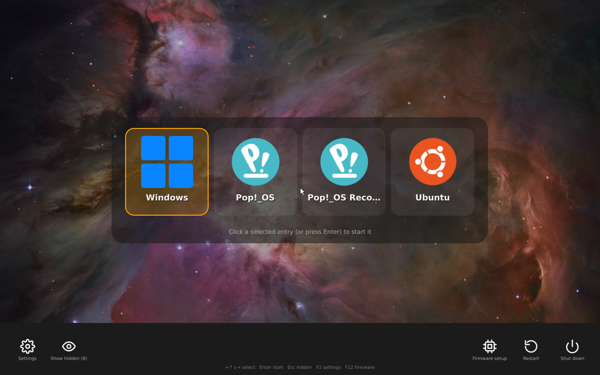
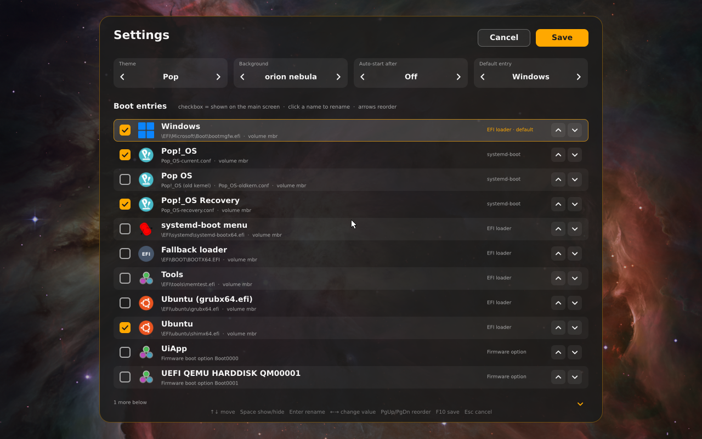

# bootpick `beta`

> **Status: beta.** Tested in QEMU/OVMF and on one real machine so far: an
> AMD Ryzen 4000 laptop with Insyde UEFI firmware, NVMe + SATA disks, booting
> Windows, Pop!_OS (systemd-boot), Ubuntu and elementary OS (shim/GRUB, on
> separate disks); mouse and touchpad
> work through the firmware's own pointer drivers. Try it from a USB stick
> before installing it on an internal disk, keep your existing boot loaders
> in place (the installer does), and know how to reach your firmware's boot
> menu. Mouse support depends on the firmware exposing a pointer device.


A mouse-driven, themeable boot picker for UEFI machines, written in Rust
(`no_std`, [uefi-rs](https://github.com/rust-osdev/uefi-rs)). It replaces the
GRUB / systemd-boot text menu with big icons, a wallpaper, and a settings
screen to rename, hide, and reorder entries without editing files.





*Screenshots taken in QEMU/OVMF at 1280x800 with the "Pop" theme and a NASA wallpaper.*

## What it does

- Finds everything bootable by itself: Windows (`bootmgfw.efi`), systemd-boot
  entries (`\loader\entries\*.conf`, started through systemd-boot with
  `LoaderEntryOneShot`), vendor loaders under `\EFI\<vendor>\` (shim/GRUB),
  loose tools, and the firmware's own `Boot####` options (started via
  `BootNext`).
- Shows only the main operating systems by default. Fallback, recovery,
  "old kernel", MokManager and firmware entries are hidden; Esc reveals them.
- Settings (gear icon or F2): checkboxes to show/hide, click a name to rename
  it, arrows to reorder, theme and wallpaper pickers with live preview,
  auto-start timeout (5 to 60 s), default entry ("Last selected" starts
  whatever was picked on the previous boot). Saved to
  `EFI\bootpick\bootpick.conf`.
- Firmware setup, restart and shut down buttons.
- Mouse (Simple Pointer), touch (Absolute Pointer) and keyboard. Keyboard is
  always enough: arrows, Enter, Esc, F2 settings, F12 firmware setup, `d`
  shows a debug line with pointer stats.
- Scales with the screen resolution; works on any UEFI firmware. Secure Boot
  must be off, or the binary must be signed with your own key.
- 34 languages (the same list as the 3m4 apps): a picker at the top right
  with flags and native names. Text is shaped with rustybuzz, so Hindi, Thai
  and Arabic (right to left) render correctly; CJK, Devanagari, Thai and
  Arabic glyphs come from Noto subsets of about 630 KiB in total.
- A desktop app, **bootpick settings**, with a live preview rendered by the
  same code as the boot menu: language, timeout, default entry, entry names,
  logos (import any image), backgrounds (add or remove), a theme editor with
  colour pickers, and buttons to disable or uninstall bootpick. It detects
  the real OS behind each loader (for example elementary OS installed in an
  `\EFI\ubuntu` folder) from `os-release`.


## Build

```sh
tools/build.sh      # as your normal user: UEFI menu, settings app, assets
```

It runs `cargo build --release --target x86_64-unknown-uefi --manifest-path
uefi/Cargo.toml`, `cargo build --release -p bootpick-config` and, when the
generated assets are missing, `tools/build-assets.py` (icons, wallpapers,
flags and font subsets; needs `uv`, cairo and the Noto fonts).

## Try it in QEMU

```sh
tools/qemu.sh            # window; needs qemu-system-x86_64 with EDK2 firmware
tools/qemu.sh headless   # VNC :9 + monitor socket; drive with tools/qemu-ctl.py
```

The `esp/` folder is the test disk. `tools/qemu.sh` puts a dummy loader at the
Windows, systemd-boot and Ubuntu paths so chainloading can be exercised.
Stock OVMF/EDK2 firmware has no USB mouse driver. `assets/drivers/` ships
prebuilt `UsbMouseDxe.efi` and `UsbMouseAbsolutePointerDxe.efi` (EDK2
MdeModulePkg, BSD-2-Clause-Patent); they are copied to
`EFI\bootpick\drivers\` and bootpick loads anything found there before
scanning for pointer devices. The same mechanism helps on real firmware that
exposes USB but has no mouse driver. Rebuild them with:

```sh
git clone --depth 1 -b edk2-stable202505 https://github.com/tianocore/edk2 && cd edk2
git submodule update --init --depth 1 BaseTools/Source/C/BrotliCompress/brotli
make -C BaseTools && . edksetup.sh BaseTools
build -a X64 -t GCC -b RELEASE -p MdeModulePkg/MdeModulePkg.dsc -m MdeModulePkg/Bus/Usb/UsbMouseDxe/UsbMouseDxe.inf
build -a X64 -t GCC -b RELEASE -p MdeModulePkg/MdeModulePkg.dsc -m MdeModulePkg/Bus/Usb/UsbMouseAbsolutePointerDxe/UsbMouseAbsolutePointerDxe.inf
```
(needs `nasm`; the `.dec` parser wants the other submodule include dirs to exist, empty is fine).

In the QEMU monitor, `mouse_set 3` routes both motion and buttons to the USB
mouse; with the tablet active, buttons go to the absolute device instead.

## Install

Try it from a USB stick first (FAT32-formatted, mounted):

```sh
tools/make-usb.sh /media/$USER/MYUSB
```

Then boot the stick from the firmware boot menu. When happy:

```sh
sudo ./install.sh           # boot menu + "bootpick settings" app, then opens the app
sudo ./install.sh --uninstall
```

The installer copies the menu to `/boot/efi/EFI/bootpick`, adds a firmware
boot entry first in the boot order, installs `bootpick-config` with a
desktop entry, and opens it. GRUB, systemd-boot and the Windows boot manager
stay where they are; the firmware boot menu can still start them directly.

### The settings app

`bootpick-config` runs as your user and asks for authorization once
(`pkexec bootpick-config --helper`). The helper copies `\EFI\bootpick` to a
private staging folder, the app edits that copy, and Save writes back only
`bootpick.conf`, `icons\*.bmp` and `backgrounds\*.bmp` (regular files, size
limited). "Disable bootpick" marks its firmware entry inactive so the next
loader in the boot order starts; nothing is deleted. "Uninstall" removes the
menu, its boot entry and the app.

**Other boot menus.** When bootpick starts Ubuntu or elementary OS, their
GRUB shows a second menu; systemd-boot (Pop!_OS) can too when the firmware
starts it directly. The app lists these menus and offers to hide them:

- GRUB: adds a marked block to `<grub dir>/custom.cfg` (sourced by
  `41_custom`, so it survives `update-grub`) that sets `timeout=0` and
  `timeout_style=hidden` (also after a failed boot: GRUB's `recordfail` flag
  stays set when a system is not booted to the end). Hold Shift or press Esc
  to see the menu anyway.
- systemd-boot: sets `timeout 0` in `\loader\loader.conf` and keeps the old
  line in a comment. Hold Space to see the menu anyway.

"Show menu again" removes exactly what bootpick added. Disabling or
uninstalling bootpick restores every menu it hid, so the next boot loader is
still a way to reach all systems.

`bootpick-config --demo DIR[:LABEL],DIR2[:LABEL]` runs without root against
plain folders (used for the screenshots above).

## Troubleshooting

- bootpick writes a log of every run to `EFI\bootpick\bootpick.log` on the
  partition it started from: firmware, volumes, entries, input devices and
  each launch step. If something hangs after you pick an entry, the log shows
  whether bootpick handed over to the loader.
- Some firmware (seen on an Insyde laptop with a Kingston DataTraveler Duo)
  hangs at the logo whenever that USB stick is plugged in, with or without
  bootpick. If testing from USB hangs only for some entries, try the same
  entry from the firmware's own boot menu with the stick plugged in.
- To get back to the previous boot loader: pick it from the firmware boot
  menu (F12 on many laptops), boot Linux and run `sudo ./install.sh --uninstall`.

## Customising

- Icons: 256x256 32-bit BMP files in `EFI\bootpick\icons\`. An entry's icon is
  chosen from its title (`os_win`, `os_pop`, `os_ubuntu`, …) and can be
  overridden with `icon = <name>` in its `[entry]` section.
- Wallpapers: 24-bit BMP files in `EFI\bootpick\backgrounds\` (any size, they
  are scaled to cover the screen). Add your own with
  `tools/build-assets.py` after dropping a JPEG/PNG in `assets/backgrounds/`.
- Themes are built in (`midnight`, `pop`, `nord`, `ember`, `light`); see
  `src/config.rs` to add one.

## Layout

| path | role |
| --- | --- |
| `core/` | `no_std` library shared by both programs: renderer (`gfx`), text shaping and font fallback (`text`), BMP, config and themes, i18n, scanning rules (`scan`), the menu state machine (`menu`) |
| `uefi/` | the boot menu: GOP output, mouse/keyboard input, volume and firmware scanning, chainloading, breadcrumb log |
| `config/` | the desktop settings app (egui) and its privileged helper |
| `assets/i18n/` | UI strings (`strings.json`) and locales (`langs.json`); `tools/gen-i18n.py` generates `core/src/i18n_data.rs` |
| `tools/` | build, asset generation, QEMU harness, USB stick helper |

## License

MIT. Fonts: DejaVu (Bitstream Vera license); Noto Sans CJK, Devanagari, Thai
and Arabic subsets (SIL OFL 1.1). Flags: lipis/flag-icons (MIT). UI and generic icons: Font
Awesome Free 6.7.2 (icons CC BY 4.0, see `assets/fa/LICENSE.txt`).
Distribution logos belong to their projects; the Pop!_OS, Ubuntu, elementary
and other distribution artwork comes from the Pop icon theme.
